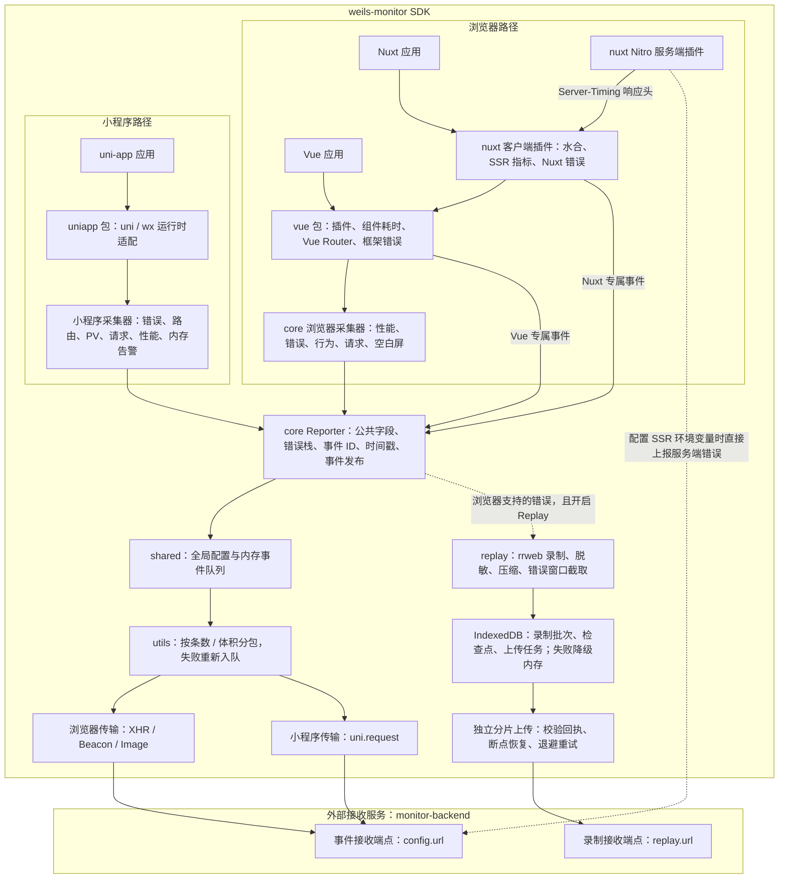
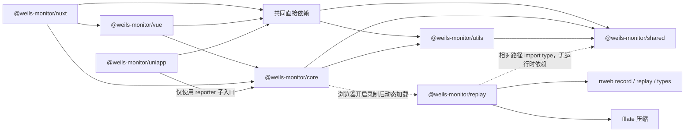

# weils-monitor 架构与目录结构

本仓库是基于 pnpm workspace、Turborepo、TypeScript 和 tsup 的前端监控 SDK monorepo，共有 7 个 SDK 包和 3 个接入示例。下图按当前源码绘制；`monitor-backend` 和管理工作台是独立项目。

## 运行时架构与数据流

实线表示调用或数据流，虚线表示可选功能。Reporter 是 `core` 提供的公共上报原语，浏览器和小程序通过不同适配器使用它。



- `vue` 使用浏览器采集器，并补充 Vue 组件、路由和框架错误。
- `nuxt` 客户端复用 `vue`；Nitro 插件把 SSR 耗时写入响应头，由客户端读取后上报。服务端错误直报还需配置 `MONITOR_SSR_ENDPOINT`、`MONITOR_SSR_APP_ID` 和 `MONITOR_RELEASE`。
- `uniapp` 使用自己的采集器、公共字段适配器与传输策略，复用 `core/reporter`，不启动浏览器 DOM 采集或 Replay。
- 浏览器与小程序路径分别选择对应传输，单次运行不会同时发送两遍。
- 普通事件队列目前只有内存缓存；IndexedDB 属于 Replay 独立存储。当前未实现普通事件的 IndexedDB、uni Storage 或文件系统持久化。
- 图中的接收地址由配置决定；本地联调普通事件通常为 `/api/v1/monitor`，Replay 默认是 `/api/v1/records`。

## 包依赖结构

下图的实线箭头表示直接依赖，虚线单独标明延迟加载和源码类型引用。为保持可读性，`nuxt/vue/uniapp` 到 `shared/utils` 的共同依赖由公共节点汇总表达。



| 包 | 核心职责 |
| --- | --- |
| `shared` | 事件与配置类型、默认配置、SDK 版本、跨模块副本共享的配置和队列 |
| `utils` | 更新配置、性能评分、批量信封、体积分包和发送策略 |
| `core` | 浏览器采集器、事件规范化、错误栈处理、Reporter 工厂、采集注册表、Replay 控制器 |
| `vue` | Vue 插件安装、组件耗时、Vue Router 变化、Vue 错误处理和采集入口 |
| `nuxt` | Nuxt 模块、客户端自动接入、水合、SSR 指标与服务端插件 |
| `uniapp` | 小程序运行时、采集器、实时页面归属、设备上下文和 uni.request 上报 |
| `replay` | rrweb 录制、隐私过滤、压缩、IndexedDB 存储、可靠上传及独立播放器入口 |

`core/reporter` 是 `core` 包的子入口，不是第 8 个包。虽然 `core` 在包清单中依赖 `replay`，uniapp 的运行时上报路径不加载录制器。

## 目录结构

省略 `node_modules`、构建产物与缓存目录，保留影响架构理解的源码层级。

```text
weils-monitor/
├─ packages/                         SDK 源码
│  ├─ shared/src/
│  │  ├─ types/                      公共事件与配置类型
│  │  ├─ constants.ts                默认配置、版本、全局共享状态
│  │  ├─ queue.ts                    内存事件队列
│  │  └─ replay.ts                   Replay 公共类型
│  ├─ utils/src/
│  │  ├─ setConfig.ts                更新共享配置
│  │  ├─ send.ts                     批量信封、分包与传输策略
│  │  └─ getRating.ts                性能评分
│  ├─ core/src/
│  │  ├─ runtime.ts                  内核初始化与采集注册
│  │  ├─ reporter.ts                 事件处理工厂与无 DOM 子入口
│  │  ├─ context.ts                  公共字段与 query 脱敏
│  │  ├─ error/                      错误采集与错误栈解析
│  │  ├─ performance/                浏览器性能指标
│  │  ├─ behavior/                   点击、PV 等用户行为
│  │  ├─ http/                       fetch / XHR 请求采集
│  │  ├─ stability/                  空白屏检测
│  │  └─ replay.ts                   按需加载录制器、关联错误事件
│  ├─ vue/src/
│  │  ├─ index.ts                    createMonitor 与 Vue 插件
│  │  ├─ performance/                组件与页面渲染耗时
│  │  ├─ behavior/                   Vue Router 适配
│  │  └─ error/、stability/           框架入口与公共采集器复用
│  ├─ nuxt/src/
│  │  ├─ module.ts                   注册客户端与服务端插件
│  │  └─ runtime/
│  │     ├─ plugin.client.ts          安装 Vue SDK 并自动启动
│  │     ├─ wire.ts                  接线与生命周期管理
│  │     ├─ hydration.ts             水合指标
│  │     ├─ ssr.ts                   读取 Server-Timing
│  │     ├─ errors.ts                Nuxt 客户端错误
│  │     └─ server/plugin.ts         SSR 耗时与可选服务端错误直报
│  ├─ uniapp/src/
│  │  ├─ index.ts、options.ts         入口与采集开关
│  │  ├─ runtime.ts                  uni / wx 解析与兜底
│  │  ├─ adaptor.ts                  设备、网络、页面等公共字段
│  │  ├─ route.ts                    页面状态与 PV 去重
│  │  ├─ reporter.ts、transport.ts   Reporter 适配与 uni.request
│  │  └─ error/、behavior/、performance/、stability/
│  └─ replay/src/
│     ├─ index.ts                    录制窗口、持久化和上传任务
│     ├─ storage.ts                  IndexedDB 与内存降级
│     ├─ privacy.ts                  录制隐私过滤
│     ├─ codec.ts                    压缩、校验和分片
│     └─ player.ts                   独立回放入口
├─ example/
│  ├─ vue/                           Vue + Vite 接入示例
│  ├─ nuxt/                          Nuxt 接入示例
│  └─ uniapp/                        HBuilderX / 微信小程序示例
├─ docs/                             接入、协议、架构与排障
├─ scripts/                          根级冒烟、导出检查、清理
├─ .changeset/                       版本发布配置
├─ package.json                      根级构建和验证命令
├─ pnpm-workspace.yaml               packages/* 与 example/*
├─ turbo.json                        任务依赖与构建缓存
└─ tsconfig.base.json                共享 TypeScript 配置
```

各包还包含自己的 `package.json`、`tsup.config.ts` 和 TypeScript 配置；冒烟脚本分布在根目录及 `core/vue/nuxt/uniapp` 的 `scripts/` 中，Replay 测试位于 `packages/replay/src/replay.test.ts`。

## 关键入口

- Vue 接入：[packages/vue/src/index.ts](../packages/vue/src/index.ts)
- Nuxt 模块：[packages/nuxt/src/module.ts](../packages/nuxt/src/module.ts)
- uni-app 接入：[packages/uniapp/src/index.ts](../packages/uniapp/src/index.ts)
- 公共 Reporter：[packages/core/src/reporter.ts](../packages/core/src/reporter.ts)
- 批量上报：[packages/utils/src/send.ts](../packages/utils/src/send.ts)
- Replay 存储：[packages/replay/src/storage.ts](../packages/replay/src/storage.ts)
